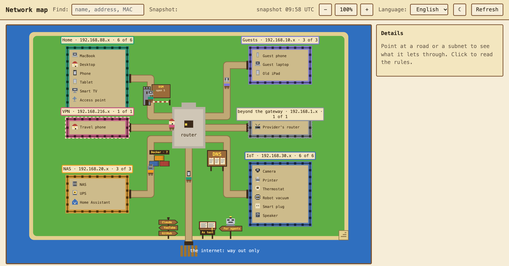
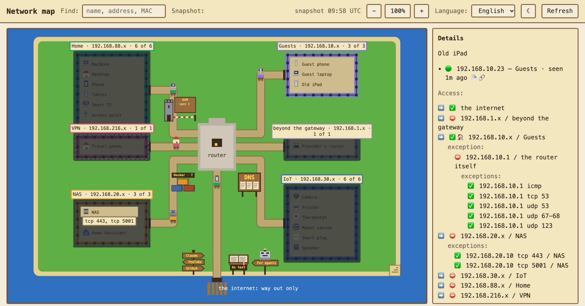
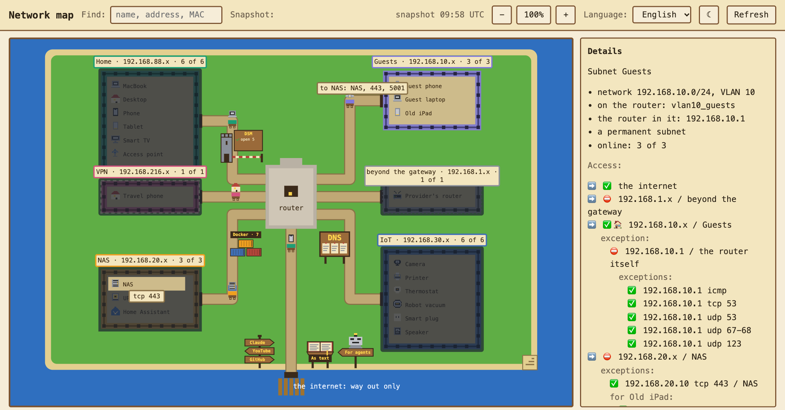
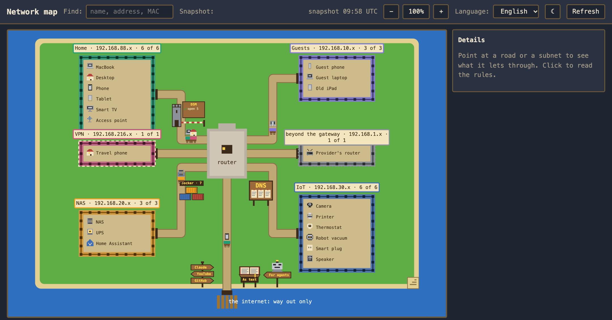

# lan-map

A map of the home network drawn as a retro RPG. Read-only — it changes nothing in the
network, ever.

The field is the whole network. A fenced yard is an isolated subnet. Houses in it are devices.
Roads are who may open a connection to whom, and every road between subnets goes through the
router in the middle.

## Screenshots

A made-up home network — Home, Guests, a NAS network, IoT, the VPN, and the provider's router
beyond the gateway — drawn by the map. Nothing in it is anybody's: see "Try it without a
router" below.



Through a device's eyes — a guest's old iPad: fog over everything it may not reach, the NAS
showing through on the two ports it may use, and its access in the scroll, line by line, with
the exceptions under each place.



Through a whole subnet's eyes — the guests: the sign at their gate names what the road to the
NAS lets through, and what one of their devices has on its own stands under its name.



The same map in the dark theme.



## What the map shows

| On the map | In the network |
|---|---|
| Fenced yard | a subnet: Home, Lab (VLAN 30), NAS (VLAN 20), guests (VLAN 10), UPS (VLAN 40) |
| House in a yard | a device online right now. The rest are counted on the sign: "Home · 9 of 28". A WireGuard peer counts as one: it has no lease and no ARP record, so the router's peer list is the only place it exists |
| Paved road | anything may pass |
| Narrow path | only certain ports |
| No road | shut |
| Road in fog | a rule with a condition we could not read |
| Pier with a gate | out is open to everything except the listed networks |
| Mask at the gate | the name changes on the way: whoever is called sees the router |
| Bridge | two roads crossed: the upper one goes over, the lower one under |
| Cart | a live connection right now: the more of them, the more carts |
| Red flag | open with no rule: RouterOS lets through by default |
| Moss on a road | the rule has not fired in a long time |
| The same house in two yards | one device in several networks: it stands in each of them, and behind it lies the shadow of itself in the other one's colour. Point at it and every copy lights up |
| Tunnel | a network that comes and goes — the Back to Home VPN — while nobody is known to be in it. Once it has members it is drawn as a yard like any other, with a dashed fence |
| Yard with a fence of loose stones | the private network beyond the gate — "beyond the gateway" — when the way out does not lead straight to the internet: not ours, so it has no lines of access of its own, no fog through its eyes, and the map knocks at no doors in it. Its houses are those the router has met there, named like any other |

That is all that is on the map itself. Ports, rules and counters appear on hover and in the
scroll on click.

A subnet has one road, and it runs at right angles only, as far as the router. Every
direction lives on it together: the width is taken from the freest, and the sign at the gate
shows the narrowest ("to Home: only the NAS"). The sign stands only while that subnet is looked
through — a click on its heading or fence — so that the map at rest is not covered in boards.
The full list is on hover and in the scroll.
When one wall of the router gets crowded, the router grows: a busy crossroads ought to look
big. Where roads cross anyway, one goes over a bridge rather than merging.

The map can be laid out to taste: subnets, the router and the way out are dragged with a
mouse — a subnet by its name board alone, so that a click in its yard stays a click. The roads are recalculated as you drag — they are tied to subnets, not
to points on the canvas, and they follow. Houses stand in their subnet's yard and travel with
it. The layout lands in `data/layout.json` and is the same for everyone who opens the map: it
is shared, not one per viewer.

A device's house is drawn by its kind: a house by default, while "nas", "console", "ups" and
the rest are chosen in the atlas. Every picture is a character grid in `web/sprites.json`,
drawn by `web/sprites.js`. A kind that is not in the set the map does not invent: it draws a
house and says so in the journal of findings.

The interface around the map:

- **Layers** (rules, devices, findings, carts) and **how access is shown** (the width of the
  road, a barrier at the gate, or a flag) are switched in the right-click menu on the grass:
  the top bar is no place for them, and they are on by default anyway.
- **Through its eyes:** poke a house and fog covers everywhere it cannot reach, while the
  scroll says where and on which ports it does go: one line per place — the internet first,
  then the networks by their numbers — each led by ➡️ and a mark (✅🏠 its own, ✅ open, ⛔
  shut) whose meaning shows under the pointer, together with the router's own name for the rule
  that shuts the way — «between networks, everything else — no»; the line itself carries no rule
  names. What goes the other way follows the word "exception", each on a line of its own, a step
  in: under «✅ internet» the pieces it leaves out, «⛔ 10.0.0.0/8», each with its own rule under
  its mark; under a dark network an address open in it, or an address and a port, «✅
  192.168.20.10 tcp 8065 / NAS», ports in the order of their numbers. In a subnet's view, what
  one device of the subnet has on its own stands under its name, «for iPad 8:», beside what
  the whole subnet has. The router has no line of its own: its address in the onlooker's
  network is one of that network's, so it stands inside that network's line, as an exception
  when it is not as open as the rest — «⛔ 192.168.10.1 / the router itself» with its open ports
  as exceptions of its own. A line of an address, or of an address and a port, carries what a
  human wrote down about it — what sits there and why it is open, «✅ 192.168.20.10 tcp 443 —
  the password vault»; from a network that may move things, the ✎ after the line writes it in
  place, and Escape leaves it as it was. The router's lines are noted once for every network,
  whichever of its addresses they show. A seat says online or old lease and how the
  router knows it in marks too (📄 lease, 🔗 ARP, 🔐 VPN peer, 🗺️ the router's own map). A click on a subnet's heading or fence
  does the same for the whole subnet: dark is what none of its devices may reach. A network
  reached whole but on some ports only is striped, the ports written on it; a network where
  only some machines are reached, by rules of their own, stays dark and those machines show
  through it, each with its ports. A rule meant for a few devices of the subnet is not the
  subnet's reach: that network is striped, "only for" those devices. The fog is looked
  through, not clicked: a click on a dark network turns the eyes to it. What decides is
  `web/sight.js`, checked by the tests without a browser. Clear the fog with the button in
  the scroll, with `Esc`, or from the menu on the grass.
- **Name and kind** of a device are chosen on the map itself and land in the atlas next to the
  snapshot.
- **Refresh:** the router's snapshot and the NAS's containers, taken anew at once — the very
  call any reader can make, `POST /api/refresh` (see "For readers who are not people").
  Nothing takes them on a schedule: the page asks by itself when it opens on a snapshot older
  than ten minutes, and agents ask before they read.
- **The journal of findings:** what changed since the last snapshot, roads open with no rule,
  dead rules with a ready line for the router (a human runs it), devices with no name.
- **Who sees the map:** tick boxes per subnet. Your own network cannot be unticked — nobody
  would be left to tick it back.
- **A house** — the whole conversation happens in the scroll: a click hides what the device
  cannot see and answers where it goes, in three lists. Where it may go, subnet by subnet;
  where it may not, which is the half one usually came to check and used to take counting on
  one's fingers; and separately the subnets it may not enter but for one device in them, on
  named ports. Beside all that: buttons to pin, hide, copy the address and the MAC, a name
  field and the set of icons.
- **Right click** — do something to this thing without taking your eyes off the map:
  a subnet — name, colour, fold the yard, sorting, columns;
  a road — the rules, "what shuts it", a line for the router;
  the router — take a fresh snapshot; the grass — visibility, layers, how access is shown,
  "lay out again", save as a picture.
- **A cart stands still while the mouse is on it**, and for ten seconds after it leaves.
  Otherwise its caption cannot be read: the cart rolls out from under the cursor mid-sentence.
  The caption names what the cart carries, too: the doors its rider knocks at on the far end
  of that road — `192.168.88.1:53 udp — dns` and the like.
- **Where a walk goes is named, not numbered.** The router keeps a cache of every name he
  resolved for the network, so the map reads the far end back out of it and says who is there:
  `YouTube (213.157.200.141):443 — https`. Nothing is looked up — what he never resolved, and
  what a device resolved for itself behind encrypted dns, stays a number. An address with no
  name is read by the block it sits in, and that is a guess by range, so it says as much:
  `somewhere in Google (142.251.151.6)`.
- **Who the network talks to, signed by itself** — `/houses.html`, the signpost by the pier.
  Two lists and nothing to type. Known: every far end of the live connections, by the house
  its name belongs to, or by the name itself grouped under its domain, with how many
  connections it carries; a name from memory or a guess by range says so. Unknown: the
  addresses the router has never named, now or in the last two weeks — a device that asks
  for names by itself, past him. The moment he names one, it moves up to the known on its
  own. When there is nothing to look at — no snapshot, no connection table — the page says
  why rather than show empty lists as if nobody were out there.
  The signpost's planks name the three busiest far ends, reckoned the same way; with no
  connections in the snapshot they stay blank rather than guess.
- **The names the router answers himself** — `/names.html`, the notice board on his square.
  Every network's DHCP hands out the router as its DNS server, so his static records are the
  whole list of names that mean something at home; the NAS answers no names at all. The page
  shows them as he holds them, grouped by the address they answer with, and says who on the
  map holds that address: the router, a device, or nobody — a name leading to nobody gets a
  section of its own, since its device is off or gone. Below them, which DNS server each
  network's DHCP hands out: where it is not the router, those names do not work there. As
  JSON: `/api/names`.
- **What runs on the map's host, for agents** — `/containers.md` (`?lang=ru` too) and
  `/api/containers`. Agents ask "is it there already?" before they put an application on the
  NAS, and not every agent may ssh there. The answer is every compose project beside the map's
  folder: its containers with image and tag, state, health and published ports, and apart from
  them what is present but not running. The snapshot's time is at the top: the watcher takes
  one at its start and each time it is asked, never on a schedule.
  It comes from the container watcher, the service `containers` of the map's own compose
  project: the same image, no network, the Docker socket, and the folders beside the map's
  mounted read-only. Being part of the project, it runs on whatever host the map runs on. The
  map itself never touches Docker. Only names, images, states, ports and one label are copied:
  no environment, no command lines, no mounts.
  That label is the home's own, `arpa.home.lan.name`: the name DSM's reverse proxy serves an
  app by (`map.lan.example` for the map, whose folder is `lan-map`). Docker knows no ports of
  a container in the host's network, so the list takes them from DSM's proxy, which the
  watcher reads anyway for the guardhouse: a table «port → name → where it leads», and the
  port beside the container itself — by its label, or, with no label, by a proxy name that
  starts with its project's name, since an app has one name for everything. A label naming no
  door of the proxy finds none, rather than a guess. The label works in Docker's own network
  too: Forgejo publishes its ports, and its label adds the proxy's name beside them. A name
  alone does not there: a project in Docker's network is often many containers.
  The list also names the port a new app takes next: the first of 18150, 18160, … up to 18990
  that is not behind the proxy, not published by Docker, and not listened on by the host right
  now. For the last, the map reads the kernel's own TCP tables, /proc/net/tcp and tcp6: it
  lives in the host's network, so they are the host's. Only the numbers of listening ports are
  read, and they are shown nowhere — they only decide the answer. Without the tables the port
  is named but not called free; without a reading of the proxy no port is named at all, since
  a port behind the proxy is taken even while its app is stopped.
  For people the way in is on the island: a stack of three shipping containers by the lower
  left corner of the yard of the house the map lives in — the map finds it by its own address
  on the way to the router. Its sign counts the running containers, a red flag goes up when one
  is unhealthy or the snapshot is stale or missing, and a click opens the very /containers.md
  agents read, in the page's language.
- **Cards of characteristics** — `/specs.html`: what each machine at home is made of. Pick a
  device from the map's own list and write its system and version, architecture, processor,
  physical and logical cores, RAM and its type, disks, graphics, role and notes; the name is
  the map's own name, so changing it here renames the device on the map. A device's scroll on
  the map shows its card and leads to the page. The router knows none of this and the map
  never guesses it: every line was typed by the owner or an agent, and the card says who and
  when. The fields — keys, kinds, limits — are named once, in `lan_map/specs.py`, and the page
  builds its form from them.
- **The network as text, and where an agent starts** — an open book on a lectern and a robot
  on a post, right of the road down to the pier, across from the signpost. The book's desk
  says "As text" and opens `/network.md`; the robot's plank says "For agents", points at the
  book and opens `/llms.txt`. Both open in the page's language and in a tab of their own, the
  same texts agents read (see "For readers who are not people"). Like the board, the signpost
  and the crates, they follow the pier and can be dragged aside.
- **The NAS's own gate** — a guardhouse with a striped barrier beside the yard of the house
  the map lives in. A road is the router's answer, but every `APP.lan.example` is served by
  DSM's reverse proxy on the NAS, and DSM asks again. An access profile on a name lets in only
  the networks it lists: the router lets a network reach the NAS, and DSM still answers it 403
  for that name. And a name the proxy leads on to another machine is a way past the router:
  whoever reaches the NAS reaches that machine too, so long as the NAS itself may — even from a
  network the router keeps away from it. The board says it at a glance: a lock for a name that
  turns some away, an arrow for a name that leads past a road the router keeps shut, and how
  many names let in whoever the router lets in. A red flag goes up for a way past the router,
  for a reading that is missing, stale or unclear, and for DSM's firewall when it is on or
  unread. The hint tells it in sentences, a click lists every name in the scroll, and the
  scroll of a yard or a road says what DSM changes for that network.
  The facts come from the container watcher, which reads DSM's own files through read-only
  mounts — `/usr/local/etc/nginx` and `/usr/syno/etc/firewall.d` — in the same round,
  into the same `data/containers.json`. Only names, ports, targets and allow/deny lines are
  copied. Who is turned away and who gets past the router is worked out on the map's side
  (`lan_map/gate.py`) against the router's own roads, from the map's own address. With no
  reading the board says "?" rather than draw the gate open. `/network.md` has a section on it,
  «The NAS's own gate», and `/llms.txt` sends agents there.
- **A cart bound for the router stops at the gate.** Whoever calls the router is talking to him,
  not through him — asking the DNS, or the map's own collector reading the tables — so there is
  no road onwards to draw. Such a cart arrives at the router, stands pale for three seconds
  while the goods change hands, fades out, and another sets off from its subnet.
- **Find:** a name, an address or a MAC — the houses found are framed in gold.
- **Keys:** `Esc` clears the fog, `R` refreshes, `F` finds, `1`/`2`/`3` switch how access is shown.
- **Snapshot:** you can look at how things were before — the last twelve are on the shelf.
- **The banner on top** says what changed since the last snapshot.
- **Dark theme and the language picker** are buttons in the top bar; the viewer's browser
  remembers both.
- **Zoom:** the `−` `+` buttons in the bar, or the `+`, `−`, `0` keys. The wheel deliberately
  does not zoom: scrolling is scrolling. The map always opens on the whole of itself.
- **Pan:** grab an empty spot and pull; with the middle button, even by a subnet.
- **Map size:** the corner at the bottom right pulls with the mouse. The map grows,
  subnets get more room, and they stay exactly where they stood. The size is shared, like the
  layout.

## Language

The map is written in English and says everything in the reader's language. English is the
default and the one every other language falls back to, key by key: a half-translated
dictionary shows English in the gaps rather than showing nothing.

- A dictionary is one file, `web/lang/<code>.json`, and the server and the page read the very
  same file. Two copies would drift apart, and then the picture and the text would disagree.
- **Adding a language is adding a file.** Copy `web/lang/en.json`, translate the values, and
  the picker in the bar grows an entry by itself: it is filled from `/api/langs`, which simply
  lists that directory. Nothing in the code learns the new language's name.
- The page opens in English until somebody picks a language. The browser's own list is
  deliberately not listened to: a page that guesses would open differently for every viewer
  while nobody had asked it to.
- The choice is remembered by the browser (`localStorage`) and survives reopening the page. It
  is a habit of whoever is looking, not a fact about the network, so it has no business on the
  server next to the snapshot.
- Everything with words in it takes `?lang=`: `/api/map?lang=ru`, `/network.md?lang=ru`,
  `/llms.txt?lang=ru`. Fetched directly, without `?lang=`, the answer follows the request's
  own `Accept-Language`, and failing that it is English — an agent that says which language it
  reads should be answered in it.
- Inside the map nothing is ever said in words. A road is `shut`, a finding is `mossy`, a
  device is a `printer`; the language is chosen at the very edge, in `lan_map/tongue.py` and
  `web/lang.js`. That is why one snapshot can be told in two languages without counting
  anything twice.
- `tests/test_tongue.py` guards it: every key the code can ask for must exist in English,
  every language must hold the same keys, and the holes in a phrase (`{count}`, `{name}`) must
  match between languages.

## For readers who are not people

The same facts are given as text, because an agent cannot click a map and retelling a drawing
means making things up:

- `/llms.txt` — the signpost: what lies where, in one screen.
- `/network.md` — networks, devices and permissions as tables, built afresh on every request.
- `/api/map` — the same snapshot as JSON, with every detail of the rules.
- `/api/history` — the snapshots on the shelf; any of them opens as `/network.md?at=<name>`.
- `POST /api/refresh` — fresh data before reading. It takes the router's snapshot and the NAS's
  containers (with DSM's gate) anew and answers only once both are written, so a reader does
  not poll or guess when to read again. The map walks to the router itself; the container
  watcher, which has no network, it asks with a note in the shared data folder
  (`data/containers.ask`), which the watcher looks for every two seconds between rounds, and
  it waits for a snapshot taken after the note. Anyone who may see the map may call it, from a
  script too: `curl -X POST https://map.lan.example/api/refresh`. Two guards keep the
  router from a crowd: one walk at a time — whoever asks during a walk waits for it — and a
  snapshot younger than thirty seconds is not taken again. The answer says, for each
  snapshot, when it was taken and whether it was taken now; 503 when one could not be, with
  the reason. The watcher is waited for at most thirty seconds, since DSM's proxy gives up
  after sixty.
- `/specs.md` and `/api/specs` — the cards of characteristics: what the owner's machines are
  made of, for an agent who needs facts about the computers at home instead of asking. `PUT
  /api/specs` writes one, as JSON with an `Origin` header like any write: the lines sent are
  set, empty ones wiped, the rest kept. From a network that may move things, any device's card
  and its name; from any other network the map is shown to, only the card of the device the
  request comes from — an agent writes down the machine it runs on — and never the name.
- `PUT /api/port` — what sits on a line of access and why it is open: `{key, note}`, the key as
  the scroll keeps it — the place, then the protocol and ports when there are any: `router udp
  53`, `192.168.20.10 tcp 443`, `192.168.20.x`. An empty note takes it away; at most 200
  characters. Only from a network that may move things, with an `Origin` header like any write.
  The notes come back in `/api/map` as `ports`.
- `/openapi.json` — every route the map answers, as OpenAPI 3.1, open like `/healthz`. It is
  read off the server's own table, `RequestHandler.ROUTES`, and off the handlers: the first
  paragraph of a docstring is what a route does, its code says which questions it reads and
  whom it turns away (`lan_map/api_spec.py`). The tests fail when a route has no words or the
  description and the table disagree.
- `/api/packages` — what this copy is made of, for a check of known vulnerabilities: Python, its
  distributions and Alpine's packages, each as `{ecosystem, name, version}` the way osv.dev
  names it, Alpine's by their source package (`openssl`, not `libcrypto3`), with the commit as
  `version`. Open like `/healthz`. `os.listed` false means the system's packages could not be
  read and were not checked (`lan_map/packages.py`).

## How roads are worked out

A road answers "who may CALL": established and related connections do not change its width,
they are the answer inside a conversation already begun.

- Rules are read in order, the way the router reads them: the first match decides.
- The space of addresses and ports is cut along the rules' own bounds. That is why "open to
  the whole network" and "open to 192.168.40.107-192.168.40.108" are different roads, not one.
- An empty address list opens nothing: in the router such a rule never fires.
- `!LAN` and `!192.168.88.0/24` are read as "everything but", exactly as in the router.
- An unknown condition makes a road "unread". Not "open" and not "shut": a guess on a map
  would look like a fact.
- What the map does not count at all — `raw`, `mangle`, IPsec rules — it lists out loud in the
  journal of findings.

## How it is put together

1. **Access to the router.** A separate `lan-map` user, read-only, REST API over HTTPS. It may
   log in from the NAS only.
2. **The collector.** Takes a snapshot: addresses and VLANs, DHCP, ARP, Wi-Fi clients, the
   firewall rules with their counters, NAT.
3. **The model and the rule reader.** Builds subnets, devices, and the roads of "who may go
   where and on which ports". An unknown condition gives "unread", not "open".
4. **The atlas.** A file of names: what the subnets are called, machines with no name in DHCP,
   which kind to draw. Facts come from the router, names and looks from the atlas. The layout
   is a third thing: it is changed with a mouse on the map and lands in `data/layout.json`.
5. **The page.** Draws the map from the model: pixel tiles, SVG, JS with no build step.

Python on the standard library, no dependencies.

## Who sees the map

Home and the NAS network. Who else is decided by tick boxes in the map's own settings, and
they can only be changed from Home. These are settings of the map, not of the network: the map
never changes the router.

## Setting up the router from scratch

Everything below is run by the owner in the router's terminal. It is all the map needs, and
nothing more: **no write permission anywhere**.

### 1. A group that can only read

```
/user group add name=lan-map-read policy=read,api,rest-api comment="lan-map: read only"
```

The built-in `read` group will not do: it carries `reboot`, `password` and `sensitive`. This
one carries none of them, so the map cannot restart the router, cannot change a password, and
cannot see the router's own secrets — the PSKs and passwords stay invisible to it. `api` and
`rest-api` are both needed: without them the REST endpoint answers `not allowed`.

Check what it came out as:

```
/user group print detail where name="lan-map-read"
```

The `!`-marked policies in that output are the ones the group does **not** have. `!write`,
`!policy` and `!sensitive` are the three worth looking for.

### 2. A user tied to one address

```
/user add name=lan-map group=lan-map-read address=192.168.20.10/32 comment="lan-map: the NAS" inactivity-timeout=10m
```

`address=` is the real lock: even with the password, this account cannot log in from anywhere
else. Put the NAS's address here — and, while you are still setting things up, the machine you
debug from, comma-separated:

```
/user set [find name=lan-map] address=192.168.20.10/32,192.168.88.102/32
```

### 3. The password, typed into the terminal and nowhere else

```
/user edit [find name=lan-map] password
```

The terminal opens its own editor and waits for you to type the new password there. `Ctrl-O`
saves it, `Ctrl-C` cancels. Typed this way the password never appears in a command line, so it
does not end up in the router's history, in a scrollback buffer, or in any log.

(`/password` does the same thing for the account you are logged in as: it asks for the old
password, then the new one twice.)

### 4. A certificate of its own

The map trusts exactly one certificate — the router's — so a self-signed one is right here,
and a public CA would be beside the point.

```
/certificate add name=lan-map-https common-name=192.168.88.1 subject-alt-name=IP:192.168.88.1 days-valid=3650 key-usage=digital-signature,key-encipherment,tls-server
/certificate sign lan-map-https
```

Signing takes a few seconds and prints its progress. Then hand the public half to the map:

```
/certificate export-certificate lan-map-https
```

The file appears in the router's `/file` list; copy it out and put it in
`config/router-cert.pem`:

```bash
scp -O mikrotik:cert_export_lan-map-https.crt config/router-cert.pem
```

Only the public half leaves the router. The private key never does, and `export-certificate`
without `export-passphrase` cannot take it.

### 5. The REST endpoint, open to the same two addresses

```
/ip service set www-ssl certificate=lan-map-https available-from=192.168.20.10/32,192.168.88.102/32 disabled=no
```

`available-from` is a second lock, independent of the user's: the port simply does not answer
anyone else. While you are here, shut what nobody needs:

```
/ip service set telnet disabled=yes
/ip service set ftp disabled=yes
/ip service set www disabled=yes
```

### 6. A name for the map

```
/ip dns static add name=map.lan.example address=192.168.20.10 ttl=5m comment="lan-map"
```

### 7. Check it from the machine that will be reading

```bash
curl --cacert config/router-cert.pem -u lan-map:PASSWORD https://192.168.88.1/rest/ip/address
```

A list of addresses means everything is in place. `401` means the password; `not allowed`
means the group is missing `read`, `api` or `rest-api`; no answer at all means `available-from`
or the user's `address=`.

Two more things that are not on the router:

- The password lives outside this repository: `~/.config/lan-map/router.env`, one line
  `LAN_MAP_ROUTER_PASSWORD=…`, mode 600. On the NAS the same file is `data/router.env`.
- Cyrillic does not survive `ssh router '…'` — the shell mangles it on the way. Anything with
  Russian in it (a lease comment, for instance) goes as a file: `scp -O names.rsc router:` and
  then `/import file-name=names.rsc`.

## Deploying

The map runs in Docker, behind a reverse proxy on the same host that gives it a name and a
certificate. `compose.example.yaml` is a starting point: the map in the host's network,
listening on the loopback only — so the proxy is the one neighbour whose `X-Forwarded-For` it
believes — and its container watcher with no network at all.

- The proxy needs a certificate for the map's name. Without one, a Synology NAS serves its
  own for that name, and the browser complains.
- `--no-cache` is not optional here. In one evening a cached build lied four times out of six:
  the container came up on the previous image, health was green, the page served the old
  files, and none of it showed until someone looked inside. Build with
  `--pull --no-cache` for that reason, and for fresh packages.
- The router's password goes in `data/router.env`, one line
  `LAN_MAP_ROUTER_PASSWORD=…`, mode 600. Without it the map works on the last snapshot, and
  Refresh says plainly that there is nothing to take one with.

## What lives in data/

| File | Who writes it | What it is |
|---|---|---|
| `snapshot.json` | the collector | the latest snapshot of the router |
| `before-snapshot.json` | the collector | the previous one: "what changed" is worked out against it |
| `history/` | the collector | the last 12 snapshots, for looking at how the network was |
| `names.json` | the map, with every snapshot | which name the router gave which address, and when that was last seen; forgotten after two weeks |
| `layout.json` | the map, when a thing is dragged | where things stand, the same for everyone |
| `atlas.json` | the map, when a name, a kind or a note is chosen | what a device is called and which picture to draw; what sits on a port and why it is open |
| `settings.json` | the map, when the tick boxes change | who sees the map |
| `router.env` | the owner | the router's password; never goes into git |
| `specs.json` | the map, when the owner or an agent writes a card | what each machine is made of: device key → lines, when and by whom |
| `containers.json` | the container watcher, at its start and when asked | what runs on the map's host: containers, compose projects, the folders beside the map's; nothing secret |

The router keeps a name he resolved for minutes, and a snapshot sees only the names alive at
its moment. So with every snapshot the map writes the names down in `names.json`: an address,
the name, when it was last seen — no device, nobody's history. When the cache has since let a
name go, the map still signs the address with it, marked "from memory": a guess, since
addresses are re-let.

Nothing walks to the router on a schedule. Every walk is a login the router writes into its
log, three lines each, and on 5 October 2026 the map's rounds were 426 of the log's 1106
lines, read by nobody. So the map asks the router only on `POST /api/refresh`: the button, the
page opened on a snapshot older than ten minutes, an agent before it reads. The rounds are
still there, off: `LAN_MAP_REFRESH_MINUTES` takes a snapshot every so many minutes, and
`LAN_MAP_NAMES_MINUTES` reads the DNS cache alone in between. That look caught names a
snapshot misses — 982 of the 4648 learned in 5.8 hours, beside twelve snapshots — and the owner
chose the quiet log over them.

No snapshot keeps secrets. Private and preshared keys, passwords and passphrases are dropped
the moment a snapshot is made — the WireGuard peers table carries every VPN client's private
key, and on disk that is a key to the house. Snapshots written before this are cleaned on
every start of the map, and so is any copy put back from a backup.

## Development

```bash
python3 -m unittest discover -s tests -t .
```

Take a fresh snapshot of the router — the password lives outside the repository:

```bash
LAN_MAP_ROUTER_PASSWORD_FILE=~/.config/lan-map/router.env python3 -m lan_map
```

The snapshot lands in `data/snapshot.json` and never goes into git. The sample for the tests is
made from it, anonymised:

```bash
python3 tools/make_fixture.py
```

In `fixtures/snapshot.json` the MAC addresses, device names and captions are invented. Network
addresses, rules and counters are real: the tests rest on them. People's names are taken out of
the rules' comments by the list in `data/people.txt`, one name a line, which stays out of git.

After changing the dictionaries, run the suite: `tests/test_tongue.py` will say which key is
missing and from which language.

### Try it without a router

`demo/` is a made-up network: a router's snapshot, the names and kinds of its devices, the
NAS's containers and DSM's reverse proxy. `tools/make_demo.py` writes it. The map writes into
its data folder as it runs, so give it a copy:

```bash
cp -r demo /tmp/lan-map-demo
LAN_MAP_DATA_DIR=/tmp/lan-map-demo LAN_MAP_SHOW_NETWORKS=127.0.0.0/8 LAN_MAP_ROUTER_HOST=127.0.0.1 python3 -m lan_map
```

The screenshots above are taken from it by `node tools/screenshots.mjs`: the map on a copy of
`demo/`, a headless Chrome, and the DevTools protocol over Node's own WebSocket — nothing to
install. `CHROME=` points at another Chrome, `LAN_MAP_PYTHON=` at Python 3.14.
